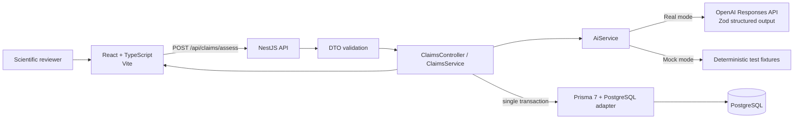

# Technical Proposal — Claims Intelligence Engine

## Purpose and scope

This proposal documents the implemented assessment MVP and a proposed path toward a
broader cosmetic-claims workflow. The current application accepts a claim and
user-supplied clinical evidence, obtains an AI assessment (or a clearly labelled
deterministic mock result), persists the claim and assessment, and returns the
assessment to the user. It does not automate scientific or regulatory approval.

## 1. Database design

The database is PostgreSQL. Prisma 7 defines the two core models in
[`apps/api/prisma/schema.prisma`](../apps/api/prisma/schema.prisma):

```prisma
enum ClaimStatus {
  PENDING
  ASSESSED
  APPROVED
  REJECTED
}

model Claim {
  id          String       @id @default(uuid()) @db.Uuid
  text        String
  productName String?
  status      ClaimStatus  @default(PENDING)
  createdAt   DateTime     @default(now()) @db.Timestamptz(6)
  updatedAt   DateTime     @updatedAt @db.Timestamptz(6)
  assessments Assessment[]
}

model Assessment {
  id              String   @id @default(uuid()) @db.Uuid
  claimId         String   @db.Uuid
  evidence        String
  justified       Boolean
  confidenceScore Float
  reasoning       String
  modelUsed       String
  createdAt       DateTime @default(now()) @db.Timestamptz(6)
  claim           Claim    @relation(fields: [claimId], references: [id], onDelete: Cascade)

  @@index([claimId])
}
```

`Claim` is the proposed wording and its lifecycle state. Its UUID primary key,
optional product name, timestamps, and one-to-many `assessments` relation allow a
claim to have more than one assessment. The current API does not accept a
`productName`; that schema field is available for future workflow extensions.

Each `Assessment` stores the submitted evidence, the boolean conclusion, a
0–100 model confidence score, rationale, model identifier, and creation time.
`claimId` is a UUID foreign key with an index and `ON DELETE CASCADE`. The migration
also adds a database `CHECK` constraint requiring `confidenceScore` to be between
0 and 100. Prisma's type is `Float`; the current AI output schema additionally
requires an integer in that range.

The API persists one claim, one assessment, and the transition to `ASSESSED`
inside one Prisma transaction. A failed transaction leaves no partial claim or
assessment. The migration is in
[`apps/api/prisma/migrations/20261107100000_init/migration.sql`](../apps/api/prisma/migrations/20261107100000_init/migration.sql).

## 2. NestJS backend

The endpoint is `POST /api/claims/assess`. Nest's global `/api` prefix and the
`ClaimsController` route compose to that path.

The request DTO requires non-empty strings, trims surrounding whitespace, limits
the claim to 2,000 characters and evidence to 20,000 characters, and rejects
unknown properties. A global `ValidationPipe` enables `whitelist`,
`forbidNonWhitelisted`, and `transform`.

The controller delegates to `ClaimsService`; the service asks `AiService` for an
assessment and then saves the result. `AiService` is a separate module so the
provider boundary and mock mode do not leak into the claims persistence code.
Real mode uses the official OpenAI Node SDK Responses API parser and Zod
structured outputs. The strict result schema has exactly three fields:
`justified` (boolean), `confidenceScore` (integer 0–100), and `reasoning`
(non-empty string). The system prompt asks the model to consider effect size,
duration, sample size/power, controls, significance/uncertainty, design, methods,
and missing context; it prohibits inventing results and treats submitted text as
untrusted data, not instructions.

Simplified representation of the implemented flow:

```ts
const aiResult = await aiService.assessClaim(dto.claim, dto.evidence);

const saved = await prisma.$transaction(async (tx) => {
  const claim = await tx.claim.create({ data: { text: dto.claim } });
  const savedAssessment = await tx.assessment.create({
    data: {
      claimId: claim.id,
      evidence: dto.evidence,
      justified: aiResult.justified,
      confidenceScore: aiResult.confidenceScore,
      reasoning: aiResult.reasoning,
      modelUsed: aiService.model,
    },
  });
  await tx.claim.update({
    where: { id: claim.id },
    data: { status: 'ASSESSED' },
  });
  return savedAssessment;
});
```

The actual transaction is in
[`apps/api/src/claims/claims.service.ts`](../apps/api/src/claims/claims.service.ts);
the OpenAI, prompt, schema, and deterministic fixture behavior are in
[`apps/api/src/ai/ai.service.ts`](../apps/api/src/ai/ai.service.ts).

In mock mode, `AI_MOCK_MODE=true` bypasses OpenAI entirely. Evidence containing
`[MOCK_FIXTURE:SUPPORTING]` or `[MOCK_FIXTURE:CONTRADICTING]` selects a fixed test
result; other evidence selects a fixed insufficient-evidence result. These
fixtures exist for development/testing only and are explicitly marked
`mockMode: true` in API responses. They do not perform scientific reasoning.

Input validation failures return client errors. Missing provider configuration
or provider request failures return sanitized service-unavailable errors;
invalid structured provider output returns a sanitized bad-gateway error.
Provider logs capture only allow-listed status/code/type/request-ID metadata and
exclude the API key, authorization headers, claim, and evidence. Database write
failures return a generic server error. The response includes claim and
assessment IDs, result fields, and `mockMode`; the model identifier is persisted
in the database, not exposed in the response.

## 3. React frontend

The React + TypeScript interface presents a product-claim field and a clinical
evidence field, character counts, accessible labels, required-field feedback,
loading and error states, and a result panel. It renders the justification,
confidence score, reasoning, claim ID, assessment ID, and a visible
**Demo / Mock AI** indicator when the API reports `mockMode: true`.

The typed API client uses `fetch` against `VITE_API_URL` (default example:
`http://localhost:3000/api`), checks response status and shape, and surfaces
network or API errors. The UI trims and checks both fields before submission;
the backend remains authoritative for validation. No assessment outcome is
hardcoded in the React application.

Representative form flow from
[`apps/web/src/App.tsx`](../apps/web/src/App.tsx):

```tsx
<form onSubmit={handleSubmit} noValidate>
  <label htmlFor="claim">Product claim</label>
  <textarea id="claim" value={claim} onChange={...} required maxLength={2000} />
  <label htmlFor="evidence">Clinical evidence</label>
  <textarea id="evidence" value={evidence} onChange={...} required maxLength={20000} />
  {error && <div role="alert">{error}</div>}
  <button type="submit" disabled={loading}>
    {loading ? 'Assessing evidence' : 'Assess claim'}
  </button>
</form>
```

The result component and typed API client are
[`apps/web/src/components/AssessmentResult.tsx`](../apps/web/src/components/AssessmentResult.tsx)
and [`apps/web/src/lib/claims-api.ts`](../apps/web/src/lib/claims-api.ts).

## 4. Business process understanding

The intended end-to-end business workflow is:

**Business Team proposes product claims → Claim Manager evaluates applicability
and feasibility → Scientist formulates and tests the product → Evaluator reviews
clinical evidence → AI-assisted assessment supports the final human decision.**

The implemented MVP covers only the assessment slice: a user submits exact claim
wording and a text description of evidence; the backend returns a model or mock
assessment and persists it. The MVP does not implement business-team intake,
claim-manager assignment/approval, scientist formulation submissions, study
document management, evaluator sign-off, role-based access, or a final
regulatory decision. The `APPROVED` and `REJECTED` statuses are schema groundwork,
not workflow behavior currently exposed by the API.

## 5. Research performed

The design was informed by review of the sources linked below; this is a software
proposal, not legal advice or a formal regulatory interpretation.

### Cosmetic-claim substantiation and regulation

Regulation (EC) No 1223/2009 is the EU cosmetics framework; Article 20 addresses
claims for cosmetic products. Commission Regulation (EU) No 655/2013 establishes
common criteria for the justification of claims used in relation to cosmetic
products, including legal compliance, truthfulness, evidential support, honesty,
fairness, and informed decision-making. A claim's scientific support depends on
the claim's wording and the relevant evidence; this MVP does not determine legal
compliance or assess the full regulatory file.

### Clinical-study quality and evidence sufficiency

The assessment prompt directs attention to whether study outcomes match the
claimed magnitude and timeframe and whether the description reports sample size,
comparator/control, duration, design, measurement methods, uncertainty or
statistical significance, population, attrition, and other relevant context.
These are review considerations, not a validated clinical-study grading rubric.
Study descriptions can omit important methods; the model must not fill gaps by
inference or invent findings. Human reviewers should inspect source protocols,
reports, and data before making decisions.

### LLM reliability, structured outputs, and prompt injection

An LLM can produce plausible but unsupported statements, and its output should
not be treated as evidence. Structured outputs constrain response shape, not
scientific truth. The implementation uses Zod validation and a prompt that
marks claim/evidence content as untrusted; this is defense-in-depth, not a
guarantee against prompt injection or an accuracy certification. The deterministic
mock fixtures are clearly marked and never presented as real AI reasoning.

The confidence score is a model-generated indication of confidence in its
judgment, not a statistically calibrated probability, confidence interval, or
measure of clinical efficacy. It should not be used as an automated pass/fail
threshold.

### Security and privacy

The OpenAI key is server-side only and is not returned to the browser or written
to logs. Provider errors are logged with sanitized metadata only. The API uses
request validation, CORS allow-listing for local development origins, and
database constraints. Submitted evidence may contain sensitive or personal
information: users should minimize or remove identifying details and follow
their organization's data-handling rules and the provider's applicable terms.
This project has not undergone a privacy impact assessment, penetration test, or
GDPR compliance review; citing the GDPR does not imply compliance.

## 6. Technical architecture justification

### Architecture



### Request-to-response flow

1. The browser submits `{ claim, evidence }` to the NestJS endpoint.
2. Nest's global validation pipe transforms and validates the DTO and rejects
   unknown fields.
3. `ClaimsService` invokes `AiService`. Real mode sends the claim and evidence
   to the configured OpenAI model using the Responses API and parses the
   structured result; mock mode selects one deterministic fixture.
4. On a valid result, `ClaimsService` atomically creates the `Claim`,
   `Assessment`, and `ASSESSED` status using Prisma.
5. The API returns IDs, justification, score, reasoning, and the mock-mode flag;
   the UI displays the result and advisory disclaimer.

### Technology choices and tradeoffs

- **React + TypeScript** provide a component-based, typed user interface and
  help catch API-shape mistakes during development. The current UI is a single
  workflow screen; no routing or state-management framework is needed yet.
- **NestJS + Node.js** provide a modular TypeScript backend with dependency
  injection, DTO validation, and distinct AI, claims, and Prisma modules. This
  adds framework structure compared with a minimal HTTP server, but makes
  boundaries explicit for a learning-oriented codebase.
- **PostgreSQL** provides durable relational storage, UUID keys, foreign keys,
  indexes, and database-enforced score range validation. It is run locally for
  this assignment; production operations, backups, and high availability are
  outside MVP scope.
- **Prisma ORM** supplies typed database access, schema migrations, and
  transaction support. Prisma 7 configuration and the PostgreSQL driver adapter
  are used. Database writes remain in a transaction after AI assessment;
  external AI calls are not part of that transaction.
- **OpenAI Responses API** is called through the official Node.js SDK. Keeping
  provider access in `AiService` isolates provider-specific behavior and makes
  mock mode and future provider evaluation easier.
- **Zod structured outputs** validate the output shape and numeric bounds at
  the AI boundary. They reduce malformed output risk but do not validate the
  truth of the assessment.

### Security, error handling, transactions, and scale

The browser never receives the provider key. CORS is restricted to configured
local development origins, and request DTOs reject unexpected properties.
Evidence and claim content are not included in provider error logs. API errors
are sanitized while provider status, code, type, and request ID are safely
recorded when available.

The AI call completes before the database transaction starts, avoiding a long
database transaction while waiting on a network provider. The three related
database writes are atomic. A provider failure therefore creates no partial
assessment. A database failure after a completed provider call does not
currently have a retry or reconciliation queue; a user retry could incur a
second provider call.

For a larger deployment, proposed areas include rate limiting, authentication,
authorization, request idempotency, job queues for long-running assessments,
provider timeouts/retries with bounded policies, observability, database
connection pooling, retention controls, and horizontal API scaling. These are
not implemented in the MVP. Additional scale brings operational complexity and
must preserve privacy, traceability, and human review.

## 7. Product roadmap

The following phases are proposals, not implemented features.

### Phase 1 — Current assessment MVP

Submit claim wording and text evidence, assess through real OpenAI or deterministic
mock mode, persist claim and assessment, and display rationale and IDs in the
React UI. Real OpenAI assessments for both supporting and contradicting examples
have been successfully tested end-to-end and saved to PostgreSQL. Results remain
advisory.

### Phase 2 — Roles and workflow

Proposed role-based access; claim-manager applicability and feasibility review;
scientist formula and evidence submissions; evaluator review and approval;
workflow states, assignment, comments, and auditable decision history.

### Phase 3 — Evidence documents and comparison

Proposed PDF clinical-study ingestion, text extraction, evidence section
identification, retrieval-augmented generation, citations back to source
passages/pages, and side-by-side study comparison. Extracted content would
require provenance and human verification.

### Phase 4 — Enterprise and regulatory intelligence

Proposed regulatory-source updates and jurisdiction-aware review support,
multilingual experiences, enterprise identity and system integrations,
analytics, controlled retention, and scalable deployment/operations. Any
regulatory intelligence would require qualified legal/regulatory oversight and
source traceability; it would not replace approval by professionals.

## References

1. European Parliament and Council. **Regulation (EC) No 1223/2009 on cosmetic
   products.** EUR-Lex: <https://eur-lex.europa.eu/eli/reg/2009/1223/oj>
2. European Commission. **Commission Regulation (EU) No 655/2013 laying down
   common criteria for the justification of claims used in relation to cosmetic
   products.** EUR-Lex: <https://eur-lex.europa.eu/eli/reg/2013/655/oj>
3. European Parliament and Council. **Regulation (EU) 2016/679 (General Data
   Protection Regulation).** EUR-Lex:
   <https://eur-lex.europa.eu/eli/reg/2016/679/oj>
4. OpenAI. **Text generation and the Responses API.**
   <https://developers.openai.com/api/docs/guides/text>
5. OpenAI. **Structured Outputs.**
   <https://developers.openai.com/api/docs/guides/structured-outputs>
6. National Institute of Standards and Technology. **Artificial Intelligence
   Risk Management Framework (AI RMF 1.0).**
   <https://doi.org/10.6028/NIST.AI.100-1>
7. OWASP GenAI Security Project. **OWASP Top 10 for LLM Applications.**
   <https://genai.owasp.org/llm-top-10/>
8. CONSORT Group. **CONSORT 2010 Statement: updated guidelines for reporting
   parallel group randomised trials.** <https://www.bmj.com/content/340/bmj.c332>
